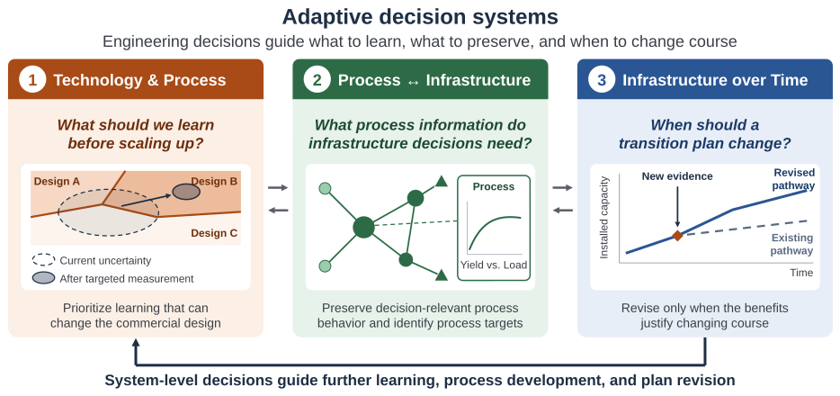
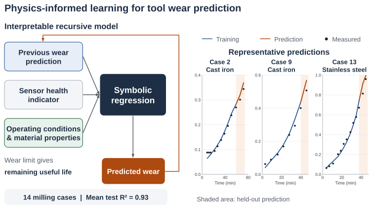
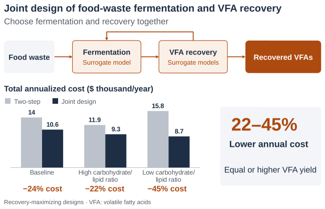
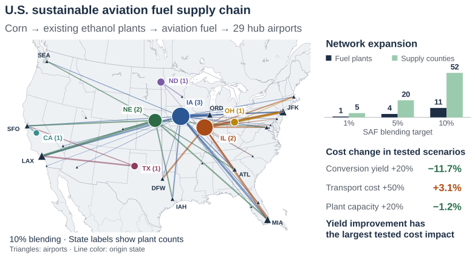

# Seulki Han, Ph.D.

**Postdoctoral Researcher**  
Department of Chemical & Biomolecular Engineering  
University of Delaware

[Email](mailto:seulkih@udel.edu) | [CV](CV_Seulki_Han.pdf) | [Google Scholar](https://scholar.google.com/citations?hl=en&user=onHXfuEAAAAJ&view_op=list_works&sortby=pubdate) | [LinkedIn](https://www.linkedin.com/in/seulkihan) | 

## Adaptive Learning and Optimization for Process and Infrastructure Decisions

**How should technologies, processes, and infrastructure be designed and transitioned together under changing and uncertain conditions?**

I develop models and optimization methods to connect technology performance with process design and infrastructure planning. My work combines physics-informed learning, process simulation, and mathematical optimization to understand how engineering choices depend on one another across scales and time.

I am a postdoctoral researcher working with Professor Marianthi G. Ierapetritou at the University of Delaware. I received my Ph.D. in Chemical and Biomolecular Engineering from the University of Connecticut in 2025, advised by Professor George M. Bollas. I earned my M.S. and B.S. in Energy and Chemical Engineering from Incheon National University, where I worked with Professor Jiyong Kim.

## Research Vision

My goal is to connect technology development, process design, and infrastructure planning through **adaptive decision systems**. I am developing a research program that uses engineering decisions to guide learning, preserves the process information needed for system-level design, and revises transition plans as new evidence emerges. Three connected questions guide this work:

- **What should we learn before scaling up?**  
  Use commercial design decisions to identify which uncertain scale-up relationships matter and prioritize measurements that help distinguish competing designs.

- **What process information do infrastructure decisions need?**  
  Preserve the process relationships needed for reliable system decisions, and translate system needs into quantitative targets for process improvement.

- **When should a transition plan change?**  
  Update planning models as new information arrives and identify when the expected benefits of revising a pathway justify the cost of changing course.

These questions form **a feedback loop**: experimental and operating information improves process models, which inform infrastructure decisions. System-level decisions then guide further learning, process development, and plan revision.

Initial applications will focus on **sustainable fuels, circular resource systems, and low-carbon infrastructure**.

## Selected Research

### Physics-Informed Learning for Evolving Systems

Tool degradation accumulates over time, but sensor measurements do not directly reveal the underlying wear state. During my Ph.D., I developed a physics-informed recursive symbolic regression framework that combines prior state estimates with physical knowledge in explicit mathematical expressions. The framework predicts tool wear and remaining useful life across different machining conditions.

**Representative publication**
Han, S., Awasthi, U., and Bollas, G. M. (2025). [Physics-informed symbolic regression for tool wear and remaining useful life predictions in manufacturing](https://doi.org/10.1016/j.jmsy.2025.03.023). *Journal of Manufacturing Systems*, 80, 734–748.

### Integrated Process Design and Optimization

Process performance depends on how technologies are selected and connected within the full process. My research combines process modeling and optimization to identify how these choices affect cost, energy use, and resource recovery.

For industrial carbon utilization, I combined process simulation with superstructure optimization to compare pathways for converting coke oven gas into fuels and chemicals. The preferred hydrogen pathway depended on the objective. Direct separation minimized production cost and energy use, while maximizing hydrogen recovery required additional conversion and separation steps.

**Representative publication**
Han, S., Kim, S., Kim, Y. T., Kwak, G., and Kim, J. (2019). [Optimization-based assessment framework for carbon utilization strategies: Energy production from coke oven gas](https://doi.org/10.1016/j.enconman.2019.03.007). *Energy Conversion and Management*, 187, 1–14.

<!-- Add the carbon utilization figure here. -->

My current work extends this approach to food-waste conversion to volatile fatty acids. I developed surrogate models for fermentation and recovery and embedded them in a joint optimization framework. Across the studied feedstock compositions, joint optimization reduced total annual cost by **22–45% relative to two-step optimization**, while maintaining or improving recovery yield.

**Related manuscript — under review**
Han, S. and Ierapetritou, M. A surrogate-driven optimization framework for volatile fatty acid (VFA) production and recovery from food waste. *Bioresource Technology*.

### Energy Infrastructure Design and Planning

Energy infrastructure decisions link technology selection, facility location, capacity, transportation, and investment timing. I developed a multi-period optimization model for national renewable energy infrastructure planning, showing how resource geography and transportation costs shape deployment patterns across energy carriers.

**Representative publication**
Han, S. and Kim, J. (2019). [A multi-period MILP model for the investment and design planning of a national-level complex renewable energy supply system](https://doi.org/10.1016/j.renene.2019.04.017). *Renewable Energy*, 141, 736–750.

<!-- Add the renewable energy infrastructure figure here. -->

My current work extends this systems perspective to sustainable aviation fuel, connecting seasonal feedstock availability, existing facilities, storage, transportation, and airport demand to deployment decisions.

**Related manuscript — under review**
Han, S. and Ierapetritou, M. A national-scale optimization framework for sustainable aviation fuel deployment. *Computers & Chemical Engineering*.

## Publications

### Journal Articles

1. Shapiro, A. J., O’Halloran, R. C., Tavares, D., Huynh, D., **Han, S.**, Shi, R., Gupta, Y., O’Dea, R., Haney, S., Otsuka, Y., Sadula, S., Vlachos, D. G., Ierapetritou, M., Levia, D. F., and Epps, T. H. (2026). [Forest residue harvest optimization: Spanning the bridge between plant biology and biorefinery performance](https://doi.org/10.1039/D6GC01047D). *Green Chemistry*, 28, 12662–12676.

2. **Han, S.**, Awasthi, U., and Bollas, G. M. (2025). [Physics-informed symbolic regression for tool wear and remaining useful life predictions in manufacturing](https://doi.org/10.1016/j.jmsy.2025.03.023). *Journal of Manufacturing Systems*, 80, 734–748.

3. **Han, S.**, Yang, Q., Pattipati, K. R., and Bollas, G. M. (2022). [Sensor selection and tool wear prediction with data-driven models for precision machining](https://doi.org/10.1002/amp2.10143). *Journal of Advanced Manufacturing and Processing*, 4(4).

4. **Han, S.**, Mannan, N., Stein, D. C., Pattipati, K. R., and Bollas, G. M. (2021). [Classification and regression models of audio and vibration signals for machine state monitoring in precision machining systems](https://doi.org/10.1016/j.jmsy.2021.08.004). *Journal of Manufacturing Systems*, 61, 45–53.

5. You, C.†, **Han, S.†**, and Kim, J. (2021). [Integrative design of the optimal biorefinery and bioethanol supply chain under the water-energy-food-land (WEFL) nexus framework](https://doi.org/10.1016/j.energy.2021.120574). *Energy*, 228, 120574. † Equal contribution.

6. **Han, S.** and Kim, J. (2019). [A multi-period MILP model for the investment and design planning of a national-level complex renewable energy supply system](https://doi.org/10.1016/j.renene.2019.04.017). *Renewable Energy*, 141, 736–750.

7. **Han, S.**, Kim, S., Kim, Y. T., Kwak, G., and Kim, J. (2019). [Optimization-based assessment framework for carbon utilization strategies: Energy production from coke oven gas](https://doi.org/10.1016/j.enconman.2019.03.007). *Energy Conversion and Management*, 187, 1–14.

8. **Han, S.** and Kim, J. (2017). [Optimization-based integration and analysis of a complex renewable energy system for the transportation sector](https://doi.org/10.1016/j.cherd.2017.09.029). *Chemical Engineering Research and Design*, 128, 1–14.

9. **Han, S.** and Kim, J. (2017). [An optimization model to design and analysis of renewable energy supply strategies for residential sector](https://doi.org/10.1016/j.renene.2017.05.030). *Renewable Energy*, 112, 222–234.

10. **Han, S.**, Won, W., and Kim, J. (2017). [Scenario-based approach for design and comparative analysis of conventional and renewable energy systems](https://doi.org/10.1016/j.energy.2017.04.063). *Energy*, 129, 86–100.

## Contact

**Seulki Han, Ph.D.**  
Department of Chemical & Biomolecular Engineering  
University of Delaware  

Email: [seulkih@udel.edu](mailto:seulkih@udel.edu)
